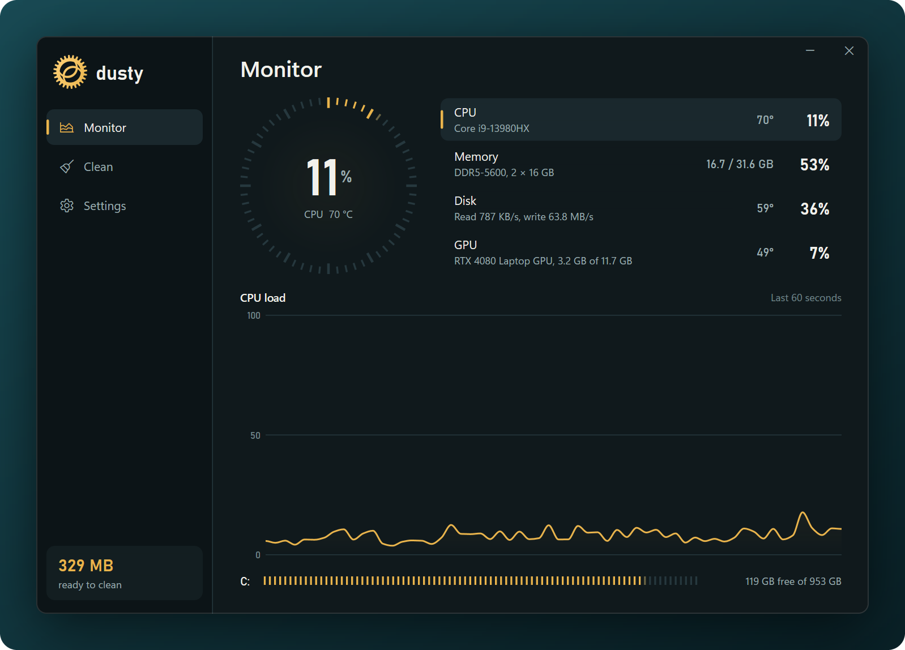
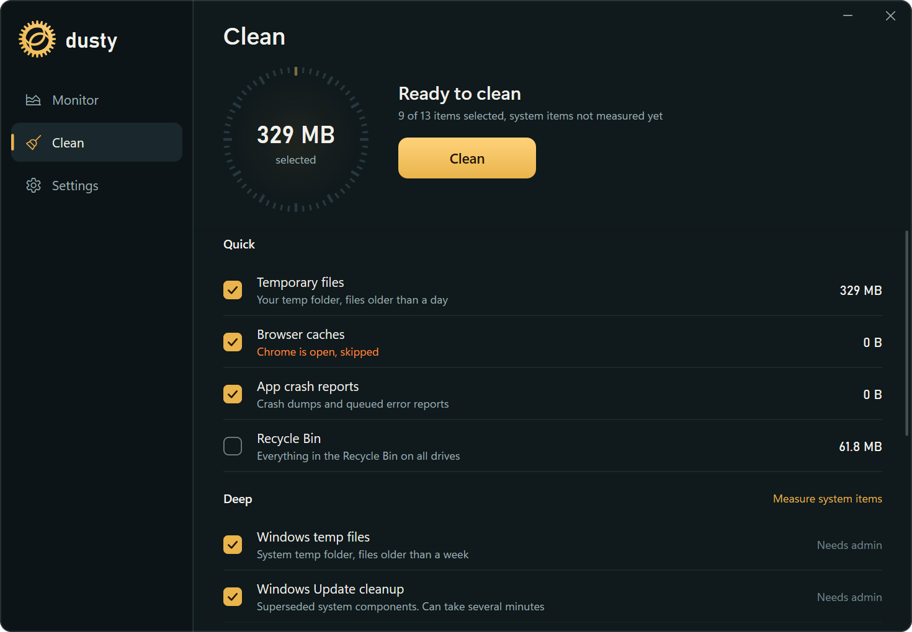
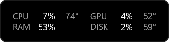
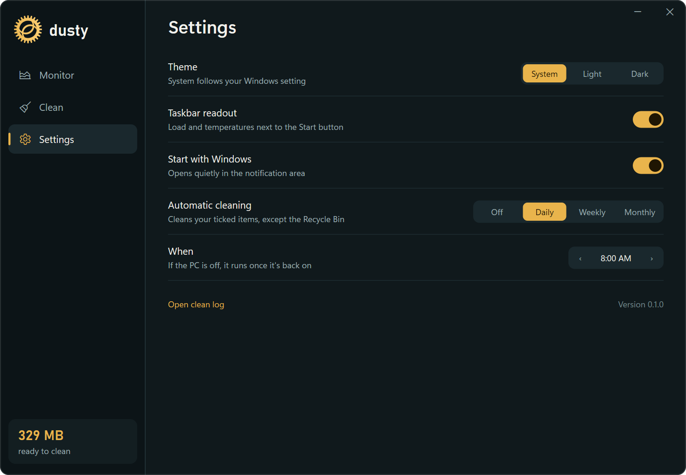

<p align="center">
  
</p>

<h1 align="center">dusty</h1>

<p align="center">
  <strong>The tiny, honest PC cleaner and system monitor for Windows.</strong><br>
  One 620 KB file. No ads, no fake boosts, no telemetry.
</p>

<p align="center">
  <a href="https://github.com/NooberCong/dusty/releases/latest/download/dusty.exe"></a>
</p>

<p align="center">
  <a href="https://github.com/NooberCong/dusty/releases/latest"></a>
  
  
  
</p>

<p align="center">
  
</p>

## Why dusty

- **Light.** One small file with no installer. Closed to the tray, it uses under 20 MB of memory.
- **Clear.** You see what each item is and how much it frees before anything is removed.
- **Careful.** System files are cleaned through Windows' own Disk Cleanup handlers, and every clean is logged.
- **Quiet.** Status text appears only when something needs your attention.

## Features

### Clean up in one click

*Quick* items need no admin rights. *Deep* items reach Windows Update leftovers, old drivers
and more. Tick what you want, and dusty skips anything in use, such as the cache of a browser
that's still open.

<p align="center">
  
</p>

### Watch your PC at a glance

See CPU, memory, disk and GPU load with a 60-second history, plus GPU and drive temperatures,
memory type and speed, and free space on each drive. CPU temperature is available on ASUS
laptops.

Keep the essentials on your taskbar too, even while Start is open. Click the readout to open
dusty, or right-click it for the menu.

<p align="center">
  
</p>

### Set it and forget it

Clean automatically every day, week or month, on the day and hour you pick. If the PC is off,
the clean runs once it's back on. Automatic cleans never empty the Recycle Bin.

<p align="center">
  
</p>

## Get started

1. **[Download `dusty.exe`](https://github.com/NooberCong/dusty/releases/latest/download/dusty.exe)**
   and keep it in a permanent folder. *Start with Windows* points to this file.
2. **Run it.** dusty isn't code-signed yet, so Windows may show "Windows protected your PC".
   Select **More info**, then **Run anyway**.
3. **Open Clean** and check the ticked items. The Recycle Bin is ticked by default, so untick
   it if you want to keep what's in there.
4. **Select Clean.** Your first clean with system items asks for administrator permission.
   Approving it adds a copy of dusty to Program Files and a scheduled task, so later cleans
   don't ask again. A new version of dusty asks once more.
5. **Open Settings** to choose a theme, a cleaning schedule and the taskbar readout.

Closing the window keeps dusty in the notification area. To quit, right-click its icon and
select **Exit**.

## What gets cleaned

| Item | Group | Ticked by default | Needs admin |
|---|---|:---:|:---:|
| Temporary files, older than a day | Quick | ✓ | |
| Browser caches, for closed browsers only | Quick | ✓ | |
| App crash reports | Quick | ✓ | |
| Recycle Bin | Quick | ✓ | |
| Windows temp files, older than a week | Deep | ✓ | ✓ |
| Windows Update cleanup | Deep | ✓ | ✓ |
| Update downloads, older than 10 days | Deep | ✓ | ✓ |
| Delivery Optimization | Deep | ✓ | ✓ |
| System error reports and dumps | Deep | ✓ | ✓ |
| Old driver versions | Deep | ✓ | ✓ |
| Developer caches (npm, pip, NuGet, Cargo, Go, Yarn, Gradle) | Deep | | |
| Shader caches | Deep | | |
| Previous Windows version | Deep | | ✓ |

## FAQ

**Is it safe?**

dusty skips files in use, never follows junctions or symlinks, and keeps each target's root
folder. It has no registry cleaner. Every clean is logged to `%LOCALAPPDATA%\dusty\clean.log`.

**Will it make my PC faster?**

It frees disk space and shows you what your PC is doing. It doesn't claim to speed Windows up,
so there's no "boost" button or RAM optimiser.

**Why don't I see a CPU temperature?**

Windows has no standard way to read it. dusty reads it from the firmware on ASUS laptops.
Other PCs would need a kernel driver, and dusty doesn't install one.

**How do I remove dusty?**

Exit dusty from the tray, then run `.\dusty.exe uninstall` from an administrator terminal in
its folder. Delete `dusty.exe`, then `%APPDATA%\dusty` and `%LOCALAPPDATA%\dusty` if you don't
want to keep your settings and log.

<details>
<summary><strong>Command line</strong></summary>

```
dusty                      open the window
dusty --tray               start in the notification area
dusty scan                 dry run: size of every item
dusty clean quick          clean the default Quick items
dusty clean deep           every default item (admin items need an elevated console)
dusty clean temp dev       specific items by id
dusty sensors              five live samples
dusty uninstall            remove the tasks and the Program Files copy (elevated console)
```

</details>

<details>
<summary><strong>Build from source</strong></summary>

Needs Rust (MSVC toolchain, pinned in `rust-toolchain.toml`) and the Windows SDK.

```
cargo build --release      # target\release\dusty.exe
cargo test                 # engine, parser and safety tests (create junctions in %TEMP%)
```

Curious how it works? Read [How dusty is built](docs/DESIGN.md).

</details>

---

<p align="center">
  Found a bug or have an idea? <a href="https://github.com/NooberCong/dusty/issues">Open an issue</a>.<br>
  dusty is free and open source under the <a href="LICENSE">MIT License</a>.
</p>
